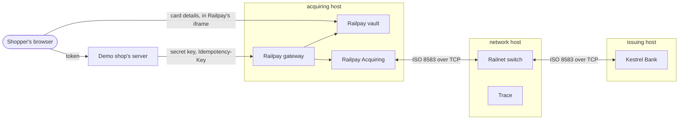
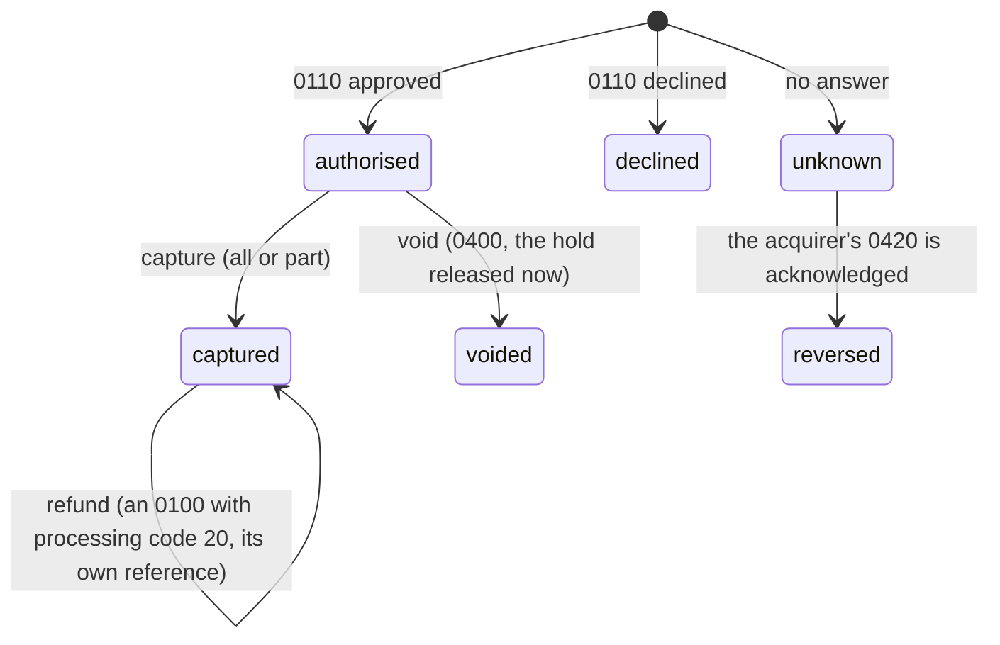
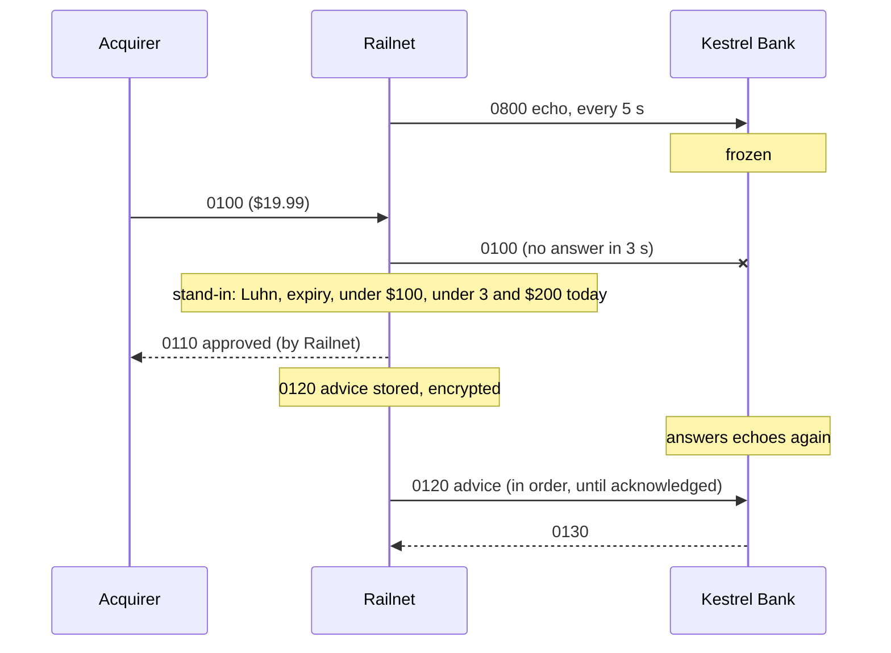

# Architecture

## Five parties, five sets of books

Each party is its own service with its own database schema and its own keys. They talk only through their
APIs, and the card network part of it only through ISO 8583 messages over TCP, as real ones do.



| Party | Owns | Never does |
|---|---|---|
| Railpay vault | Card numbers typed into the hosted form, encrypted; single-use tokens | Decide anything about a payment |
| Railpay gateway | Merchants, API keys, payments, idempotency keys | Store a card number or security code |
| Railpay Acquiring | Merchants' MIDs and terminals, every authorisation it sent, (phase 3) settlement and fees | Know whether a cardholder has money |
| Railnet | Members, the BIN table, every authorisation that crossed it and who decided it | Hold anyone's money or card data |
| Kestrel Bank | Cardholders, accounts, cards, holds, every decision | Know who the merchant's customer is beyond field 43 |
| Trace | What each party said it sent, masked | Anything a payment depends on |

## An authorisation, end to end

```mermaid
sequenceDiagram
  participant B as Browser
  participant S as Demo shop
  participant V as Vault
  participant G as Gateway
  participant A as Acquirer
  participant N as Railnet
  participant K as Kestrel Bank
  B->>V: card number, expiry, CVV (hosted form)
  V-->>B: tok_... (single use, 15 minutes)
  B->>S: checkout(product, token, orderId)
  S->>G: POST /v1/payments (secret key, Idempotency-Key = order)
  G->>V: reveal token (once; the CVV is then deleted)
  G->>A: authorise (MID, card, amount, RRN)
  A->>N: 0100 (STAN a, RRN, field 32 = acquirer)
  N->>K: 0100 (STAN n, field 33 = Railnet, field 100 = Kestrel)
  Note over K: card known? usable? expiry and CVV2 right?<br/>money for it? place a hold
  K-->>N: 0110 (39 = 00, 38 = approval code)
  N-->>A: 0110 (STAN a restored)
  A-->>G: approved
  G-->>S: payment: authorised
```

- **The card number goes from the browser to the vault and nowhere a merchant can see it.** The shop's page
  holds an iframe served by the vault; the shop gets a token, which it can only use with its own secret key.
- **One reference, every party.** The gateway gives each payment a 12-digit retrieval reference number (RRN,
  field 37), which every party records. The trace is keyed by it.
- **Each link numbers its own messages.** The acquirer's trace number (field 11) is its own; Railnet gives
  what it forwards to an issuer a number of its own and restores the acquirer's on the way back, so numbers
  from different acquirers can't collide on an issuer's link. Responses are matched by field 11 and field 37
  and may come back in any order on a connection ([`IsoLink`](https://github.com/SaiNayakk/cardrail/blob/main/common/src/main/java/app/cardrail/common/iso/IsoLink.java)).
- **A repeat gets the first answer.** The issuer records each request by acquirer, RRN and trace number, the
  network by the acquirer's, and the gateway by idempotency key. A repeat is answered from the record and
  never decided twice.
- **No answer is not a decline.** If Railnet doesn't answer the acquirer in 5 s, the payment is UNKNOWN, never
  declined, because the issuer may have placed a hold. It is reversed until someone hears it (below).

## After the authorisation



- **Dual message.** An authorisation (0100) only holds the money. Capture records how much the merchant takes;
  the money moves when the day is cleared (phase 3), and anything not captured is released then.
- **Void** sends an 0400 so the issuer releases the hold at once. If the network can't be asked, the void is
  accepted and owed as an 0420.
- **Refund** is an authorisation of its own (processing code 20, as Visa and Mastercard now require), with its
  own reference and trace. The vault keeps the card a payment was made with (without its security code) so a
  refund doesn't need the shopper again. Refunds can't add up to more than was captured.
- **Webhooks** tell the merchant each change, from an outbox, signed ([ADR-009](decisions.md#adr-009-webhooks)).
- **The merchant API has two versions** ([ADR-006](decisions.md#adr-006-api-versions)).

## When someone doesn't answer



- **The issuer is down** ([ADR-007](decisions.md#adr-007-stand-in)): Railnet stands in within Kestrel Bank's
  limits, and owes it an 0120 advice for each approval and an 0420 for any payment it forwarded but declined
  (Kestrel may approve that one late). Kestrel is bound by a stand-in approval, even over a decline of its own
  whose answer was lost.
- **The network is down** ([ADR-008](decisions.md#adr-008-reversals)): the acquirer's payment is UNKNOWN, and it
  owes Railnet an 0420 until Railnet acknowledges one. Railnet routes it to the issuer that had the original, or
  accepts it for an issuer that is down and delivers it later. A reversal of an original nobody has seen is
  remembered at the network and the issuer, so if the original arrives late it is declined there and never held.
- **Reversals carry no card number.** Field 37 (the reference) and field 90 (the original's MTI, trace number,
  time and acquirer) are enough: every party finds the original by reference.

## Card data

| Data | Where it exists | How |
|---|---|---|
| Card number | Vault (until the token expires, then deleted), Kestrel Bank | AES-GCM at rest; Kestrel finds a card by an HMAC of its number |
| Security code (CVV2) | Vault until the token's first use; in flight in field 48 | Never stored after authorisation (PCI DSS 3.2). Kestrel derives the right one from its card verification key, so it stores none |
| Everything else | Gateway, acquirer and network keep the BIN and last four | |
| Traces and logs | Masked before they leave a party: BIN and last four, no expiry, CVV, track, PIN or chip data | [`Masking`](https://github.com/SaiNayakk/cardrail/blob/main/iso8583/src/main/java/app/cardrail/iso8583/Masking.java) |

## ISO 8583 as Railnet speaks it

ASCII text fields, a binary bitmap (primary, and secondary when any field above 64 is present), binary PIN,
chip and MAC fields, each message framed by a 2-byte big-endian length. Field numbers, names and lengths follow
ISO 8583:1987, as Visa's and Mastercard's dialects do. Field 48 carries subelements in Mastercard's
tag-length-value style; subelement 92 is the CVV2. See [`MessageSpec`](https://github.com/SaiNayakk/cardrail/blob/main/iso8583/src/main/java/app/cardrail/iso8583/MessageSpec.java).

| Message | Phase | Meaning |
|---|---|---|
| 0100 / 0110 | 1 | Authorisation request and response (dual message: money moves at clearing) |
| 0800 / 0810 | 1 | Network management: echo, sign-on |
| 0120 / 0130 | 2 | Authorisation advice: what the network approved while standing in |
| 0400 / 0410 | 2 | Reversal request: a void |
| 0420 / 0430 | 2 | Reversal advice: a payment that got no answer, or a void that couldn't be asked; repeated until acknowledged |
| 0100 with processing code 20 | 2 | A refund's authorisation |

## Test cards

| Number | Kind | Outcome |
|---|---|---|
| 2860 0100 0000 0012 | Debit, $5,000 | Approved |
| 2860 0100 0000 0020 | Debit, $5 | Declined over $5: insufficient funds (51) |
| 2860 0100 0000 0038 | Debit, blocked | Restricted card (62) |
| 2860 0100 0000 0046 | Debit, reported lost | Lost card (41) |
| 2860 0100 0000 0053 | Debit, expired January 2025 | Refused by the hosted form; expired card (54) at the issuer |
| 2860 0200 0000 0011 | Credit, $2,000 limit | Approved |

Expiry 12/30 except where it says otherwise. Each card's CVV2 is shown in the demo app (it is derived from the
environment's card verification key, so it differs between environments).

## Running many services on a phone

As in Sprout, services are built separately but run in hosts, one JVM per failure domain
([ADR-005](decisions.md#adr-005-hosts)). Measured in pre-prod (2026-11-02, idle after the E2E suite):

| Host | Services | Memory |
|---|---|---|
| acquiring | gateway, vault, acquirer, demo shop | 168 MB idle, 183 MB under PERF-01 |
| network | Railnet, trace, Meridian | 155 MB idle (before Meridian), 172 MB under PERF-01 |
| issuing | Kestrel Bank | 138 MB idle, 150 MB under PERF-01 |
| **Total** | | **505 MB** under load |

## After the payment: clearing and settlement

```mermaid
sequenceDiagram
  participant A as Railpay Acquiring
  participant N as Railnet
  participant K as Kestrel Bank
  participant B as Settlement bank
  Note over A: captured sales and refunds since the last file
  A->>N: clearing file (sale $19.99, ref 630612000123)
  Note over N: matches an approved authorisation, no more than approved;<br/>interchange $0.22 (debit cap), fee 3c each side
  N->>K: clearing file (the same records, interchange filled in)
  Note over K: posts the purchase, releases the hold
  Note over N: cut-off: each member's position, net
  K->>B: pays $19.99 - $0.22 + $0.03
  B->>A: receives $19.99 - $0.22 - $0.03
  Note over A: pays the shop $19.99 - $0.50 (2.5% MDR)
```

- **Clearing** ([ADR-010](decisions.md#adr-010-clearing)): the acquirer presents what was captured (the captured
  amount, so a partial capture releases the rest of the hold at the issuer) and approved refunds. Railnet refuses
  anything it didn't approve, anything for more than approved, and anything presented before.
- **Settlement**: at each cut-off Railnet settles every member's net position through the settlement bank, and
  checks the positions add up to exactly the fees it earned. Each member reads its settlement report and books it.
- **Payouts** ([ADR-011](decisions.md#adr-011-payouts)): the shop is paid what settled, less its fee.
- **Disputes**: a cardholder disputes a cleared purchase; Kestrel Bank gives the money back at once and sends a
  chargeback in its own clearing file; Railpay tells the shop (a webhook); the shop answers with evidence (sent as a
  representment, which charges the cardholder again) or accepts it.
- **Holds** an issuer approved but that are never cleared are released after 7 days.

### Who earns what on a $100 debit sale

| Party | Gets | Pays |
|---|---|---|
| Shop | $97.50 | MDR $2.50 |
| Railpay Acquiring | MDR $2.50 | interchange $0.26, Railnet fee $0.13 |
| Kestrel Bank | interchange $0.26 | Railnet fee $0.13 |
| Railnet | $0.26 in fees | |

Each party's books: [`/api/books/kestrel`](https://cards-saiworks.nncs.in/api/books/kestrel),
`/api/books/railnet`, `/api/books/railpay-acquiring`. Each adds up to zero.
