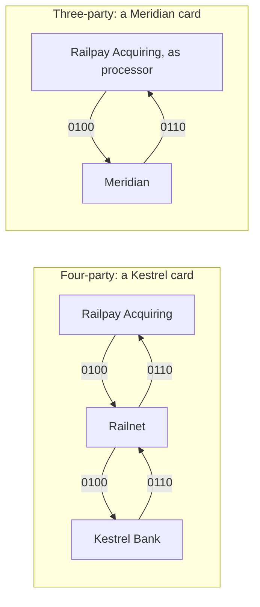

# Four parties or three: Railnet and Meridian side by side

cardrail runs both ways card payments are organised.

- **Railnet** is a **four-party** (open loop) network, like Visa and Mastercard. The cardholder's bank (Kestrel Bank)
  and the merchant's bank (Railpay Acquiring) are separate companies. The network sits between them, owns neither
  side's customers, and is paid a small fee by both.
- **Meridian** is a **three-party** (closed loop) network, like American Express (and Discover, and Diners Club in its
  time). One company issues the cards, signs up the merchants and runs the network between them.

The same shop, the same gateway, the same hosted form: only the card changes.

## The path of an authorisation

A Kestrel card's request crosses Railnet, which routes it by BIN and gives it its own trace number. A Meridian card's
goes straight to Meridian, which decides as the issuer. There is no routing, because there is only one place it can go.

## Who earns what on a $100 sale

| | Four-party (Kestrel debit) | Four-party (Kestrel credit) | Three-party (Meridian) |
|---|---|---|---|
| The merchant pays | MDR 2.50% = $2.50 | $2.50 | Discount 3.00% = $3.00 |
| The cardholder's bank gets | Interchange $0.26 (US debit cap) | Interchange $1.90 | (the same company) |
| The network gets | $0.13 + $0.13 | $0.13 + $0.13 | (the same company) |
| The merchant's bank keeps | $2.50 - $0.26 - $0.13 = **$2.11** | $2.50 - $1.90 - $0.13 = **$0.47** | (the same company) |
| One company keeps | | | **$3.00** |

Visible in the books: each party's `/api/books/...` shows its income and costs. Railnet earns only its fees. Kestrel
Bank earns interchange. Railpay Acquiring's margin is the MDR less interchange and fees, thin on credit. Meridian books
its whole discount as `income:discount`.

This is why closed loops charge merchants more, and why they can still pay generous card rewards: the whole fee is
theirs. It is also why fewer merchants accept them.

## What each sees

| | Four-party | Three-party |
|---|---|---|
| Who knows the cardholder | the issuer | Meridian |
| Who knows the merchant | the acquirer | Meridian (merchants are known by the acquirer's merchant id, signed up on first use) |
| Who sees both sides of every payment | nobody: the network sees routing data only | Meridian, for every payment |
| Who decides an authorisation | the issuer, or the network standing in | Meridian |
| Who pays the merchant | the acquirer, from net settlement | Meridian, directly |
| Disputes | issuer -> network -> acquirer -> merchant | inside one company |

Seeing both sides is the closed loop's real advantage: Meridian could score fraud using what it knows of the merchant
as well as the cardmember, and offer merchants data about their customers that no four-party participant has.

## How cardrail does it

- **Railpay Acquiring as processor.** As with American Express's arrangements with acquirers, the merchant's acquirer
  still carries the payment: it sends Meridian cards (BIN 39) straight to Meridian over ISO 8583, and submits the day's
  Meridian sales to Meridian in the same file format it uses for Railnet. It books nothing for them: Meridian pays the
  merchant itself, and Railpay shows the merchant those payouts too.
- **Meridian's cards** are fifteen digits with a four-digit security code, like American Express's. They are charge
  cards: the balance is due in full, against a spending limit.
- **No interchange, no net settlement.** Meridian posts each submitted sale to the cardmember and owes the merchant the
  sale less 3%, which it pays on its own schedule.
- **Code**: [`closedloop`](https://github.com/SaiNayakk/cardrail/tree/main/closedloop); tests CLOSED-01 and CLOSED-02.

## What a closed loop gives up

- **Reach.** Every merchant must be signed up by Meridian (or by an acquirer it works with), and every cardmember by
  Meridian. A four-party network gets both from thousands of banks.
- **Price.** Merchants pay more, so some refuse the card.
- **Resilience.** There is no stand-in: if Meridian is down, nobody else can approve its cards.
